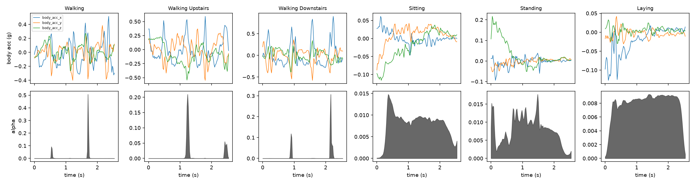
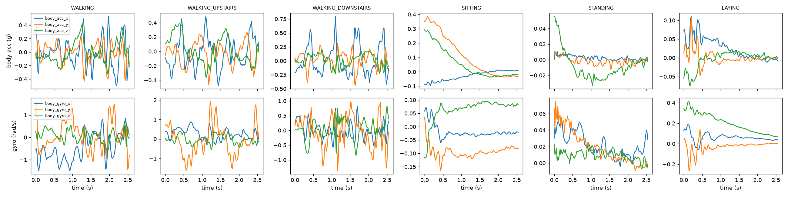
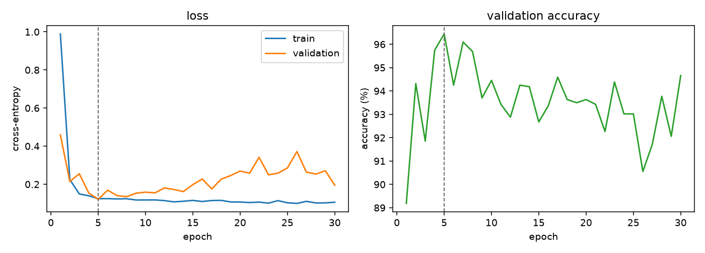
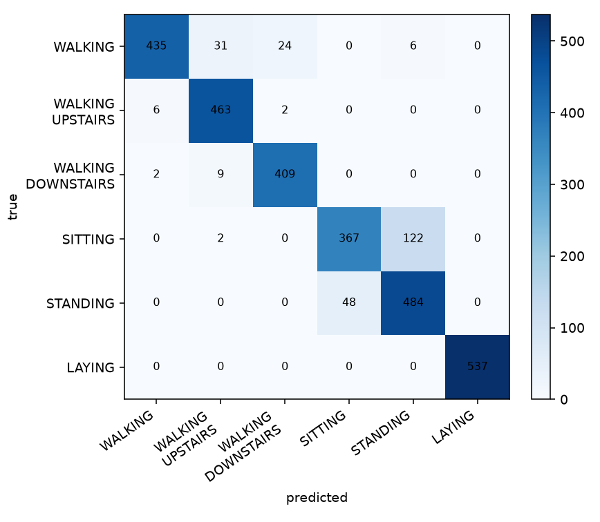
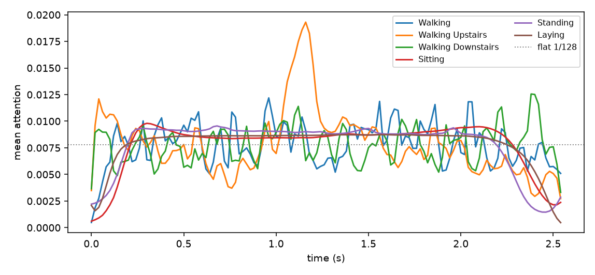

# Listening to the Rhythm of Movement: Building a BiLSTM with Attention from Scratch for Human Activity Recognition

*How a custom bidirectional LSTM with learned attention decodes 9-axis smartphone motion into human activities — and what the network actually looks at when making decisions.*

---

*Figure 1: Three-axis body acceleration alongside learned attention weights across six activities.*

---

## 1. Introduction: The Smartphone as a Biomechanical Observer

Every modern smartphone and smartwatch carries tri-axial accelerometers and gyroscopes. From a few seconds of continuous sensor telemetry, devices track steps, monitor workouts, and detect falls.

Yet, classifying human activities from raw inertial signals remains challenging. How does a model distinguish walking upstairs from downstairs? And why do waist-mounted sensors struggle to separate sitting from standing?

In this project, we built a complete Human Activity Recognition (HAR) deep learning system from first principles in PyTorch—without using black-box modules like `nn.LSTM` or `nn.MultiheadAttention`. We implemented custom recurrent cells, constructed a Bidirectional LSTM (BiLSTM) with an additive attention mechanism, trained it on the benchmark UCI HAR dataset, and deployed an interactive browser application styled after Vincent van Gogh's *The Starry Night*.

---

## 2. The Dataset and 9 Inertial Signals

The **UCI Human Activity Recognition dataset** records 30 volunteers (aged 19–48) wearing a waist-mounted smartphone performing six activities: **Walking**, **Walking Upstairs**, **Walking Downstairs**, **Sitting**, **Standing**, and **Laying**.

Signals were captured at 50 Hz and sliced into windows of **2.56 seconds (128 time steps)** with 50% overlap. Each time step provides a 9-dimensional vector:
- **Body Acceleration ($g$):** $\text{body\_acc\_x, y, z}$ (linear body acceleration with gravity removed).
- **Body Gyroscope ($\text{rad/s}$):** $\text{body\_gyro\_x, y, z}$ (angular velocity).
- **Total Acceleration ($g$):** $\text{total\_acc\_x, y, z}$ (raw acceleration including Earth's gravity).

*Figure 2: Raw sensor traces across activities (Task 1.3). Top: body acceleration; Bottom: angular velocity.*

### Moving vs. Still Activities

As shown in Figure 2, the signals exhibit a clean physical dichotomy:
- **Moving Activities (Walking, Upstairs, Downstairs):** Produce energetic, quasi-periodic oscillations from cyclic foot strikes, with acceleration swinging between $\pm 0.5g$ and angular velocity reaching $\pm 2\text{ rad/s}$.
- **Still Activities (Sitting, Standing, Laying):** Yield flat traces near zero dynamic acceleration, governed almost entirely by static gravity.

### Subject-Wise Data Partitioning

Adjacent windows overlap by 50% (1.28 s). Randomly partitioning windows would leak adjacent time slices across splits, creating artificially inflated accuracy. To evaluate real-world generalization, we isolated four volunteers (`VAL_SUBJECTS = [3, 15, 25, 30]`) for validation, leaving 17 for training and 9 for testing:
- **Train:** 17 subjects (5,881 windows)
- **Validation:** 4 subjects (1,471 windows)
- **Test:** 9 subjects (2,947 windows)

Channels were standardized to zero mean and unit variance using statistics computed strictly on the training set.

---

## 3. Building the Recurrent Layers from Scratch

Per assignment constraints, all layers were built using basic tensor operations and `nn.Parameter`.

### 1. Custom LSTM Cell (`LSTMCell`)
For input dimension $D = 9$ and hidden dimension $H = 64$, all four gate parameters are packed into unified matrices $W \in \mathbb{R}^{4H \times D}$, $U \in \mathbb{R}^{4H \times H}$, and bias $b \in \mathbb{R}^{4H}$:
$$\begin{aligned}
\begin{bmatrix} i_t \\ f_t \\ g_t \\ o_t \end{bmatrix} &= \begin{bmatrix} \sigma \\ \sigma \\ \tanh \\ \sigma \end{bmatrix} (W x_t + U h_{t-1} + b) \\
c_t &= f_t \odot c_{t-1} + i_t \odot g_t, \quad h_t = o_t \odot \tanh(c_t)
\end{aligned}$$
Weights were initialized uniformly in $[-1/\sqrt{H}, 1/\sqrt{H}]$, with $h_0 = \mathbf{0}, c_0 = \mathbf{0}$.

### 2. Bidirectional LSTM (`BiLSTM`)
A forward LSTM processes $x_1 \dots x_{128}$, while a separate backward LSTM processes the reversed sequence $x_{128} \dots x_1$. Reversing backward outputs back into chronological order and concatenating yields $h_t = [\overrightarrow{h}_t; \overleftarrow{h}_t] \in \mathbb{R}^{128}$.

### 3. Temporal Attention Pooling (`Attention`)
Instead of keeping only the final state, additive attention scores each step:
$$e_t = v^T \tanh(W_a h_t + b_a), \quad \alpha_t = \frac{\exp(e_t)}{\sum_{s=1}^{128} \exp(e_s)}, \quad c = \sum_{t=1}^{128} \alpha_t h_t$$
where $W_a \in \mathbb{R}^{64 \times 128}$, $b_a \in \mathbb{R}^{64}$, and $v \in \mathbb{R}^{64}$. A linear head maps $c$ to 6 class logits.

### Exact Parameter Count
The model contains exactly **46,982 parameters**:
- **BiLSTM:** $2 \times [4 \times 64 \times 9 + 4 \times 64 \times 64 + 4 \times 64] = \mathbf{37,888}$
- **Attention:** $64 \times 128 + 64 + 64 = \mathbf{8,320}$
- **Linear:** $128 \times 6 + 6 = \mathbf{774}$
- **Total:** $\mathbf{46,982}$

---

## 4. Training and Evaluation Results

We trained HARNet using cross-entropy loss, Adam ($\text{lr} = 10^{-3}$), batch size 64, and gradient clipping at 1.0 over 30 epochs.

*Figure 3: Loss and validation accuracy across 30 epochs (Task 3.2).*

- **Initial Loss:** 1.8049 *(theoretical $\ln 6 \approx 1.7918$)*
- **Best Epoch:** Epoch 5 (val loss: 0.1208, val accuracy: **96.44%**)
- **Test Accuracy:** **91.45%** (2,695 / 2,947 correct windows)

*Figure 4: Confusion matrix heatmap over the 2,947 test windows (Task 4.3).*

### Per-Class Performance Summary

| Activity | Test Accuracy | Mean of $\max_t \alpha_t$ |
|---|:---:|:---:|
| **WALKING** | 87.70% | 0.2978 |
| **WALKING UPSTAIRS** | 98.30% | 0.2364 |
| **WALKING DOWNSTAIRS** | 97.38% | 0.2784 |
| **SITTING** | 74.75% | 0.0144 |
| **STANDING** | 90.98% | 0.0184 |
| **LAYING** | 100.00% | 0.0106 |

---

## 5. Attention Analysis: Where Does the Network Look?

Uniform attention over 128 steps equals $1/128 \approx 0.0078$. Measuring the mean peak attention ($\max_t \alpha_t$) reveals a clear divide:

*Figure 5: Average attention curves over the 2.56-second window for each activity (Task 5.2).*

For **dynamic activities**, attention peaks sharply (~0.24 to ~0.30). The network focuses nearly 30% of its decision weight on transient impacts within the gait cycle—such as the shock of heel strikes.

For **static postures**, attention is almost completely uniform (0.010 to 0.018). Because the body is stationary, every time step carries identical postural information, so the network aggregates broadly over time.

---

## 6. Analytical Findings (Task 6 Answers)

- **6.1 Validation Split by Person:** Adjacent windows overlap by 50% (1.28 s). A random window split would place nearly identical sensor segments in both train and validation sets, causing data leakage. Splitting by subject ensures the model is tested on unseen individuals, evaluating true generalization across different gaits.
- **6.2 Confusion Between Sitting and Standing:** Sitting and standing account for almost all errors (122 sitting windows predicted as standing; 48 standing predicted as sitting). As shown in Figure 2, both postures are static with near-zero acceleration. At the waist, both orientations align similarly with gravity. Without observing the sit-to-stand transition, static tilt alone is inherently ambiguous.
- **6.3 Why LAYING is 100% Accurate:** LAYING achieved 100.00% accuracy (537/537 test windows). When upright, gravity ($1g$) projects along the phone's vertical plane (Y/Z axes). When laying horizontally, gravity shifts by 90 degrees onto the orthogonal **`total_acc_x`** axis. This large static coordinate shift is unique to laying and unmistakable.
- **6.4 Attention: Moving vs. Still Activities:** Attention is heavily peaked for moving activities (0.24–0.30) and diffuse for still ones (0.010–0.018). In dynamic movement, discriminative information is concentrated in transient impacts. In still postures, the signal is stationary; no single moment carries unique information.
- **6.5 Bidirectional Recurrence in Offline vs. Online Tasks:** BiLSTMs are permitted here because inference runs on an already-recorded 2.56-second buffer, giving the backward pass access to the full window. However, BiLSTMs are strictly disallowed in zero-latency streaming tasks (e.g., immediate fall-impact detection or causal forecasting), where future samples do not yet exist.
- **6.6 LSTM Gating and Gradient Clipping:** In a vanilla RNN, hidden updates $h_t = \tanh(W x_t + U h_{t-1} + b)$ multiply recurrent weights repeatedly over 128 steps, causing gradients to vanish. The LSTM introduces an additive cell state: $c_t = f_t \odot c_{t-1} + i_t \odot g_t$. When $f_t \approx 1$, the gradient $\frac{\partial c_t}{\partial c_{t-1}} = f_t$ flows backward with minimal decay, preserving memory over 128 steps. Meanwhile, **gradient clipping** caps gradient norms at 1.0, preventing exploding gradients and numerical instability.

---

## 7. Interactive Starry Night Front-End

We exported the trained weights to JSON and wrote a standalone JavaScript inference engine (`infer.js`) that runs client-side in the browser.

The web app features a theme inspired by Vincent van Gogh's *The Starry Night* (1889):
- Animated canvas with swirling nebulae, glowing crescent moon, and cypress silhouettes.
- Interactive sensor waveforms and real-time attention weight plots.
- Prediction probability bars and illuminated activity icons.
- CSV upload support for custom 128×9 sensor files.

- 🌟 **Live Web App:** [https://laibasan.github.io/human-activity-recognition/](https://laibasan.github.io/human-activity-recognition/)
- 💻 **GitHub Repository:** [https://github.com/laibasan/human-activity-recognition](https://github.com/laibasan/human-activity-recognition)

---

## 8. Conclusion

By building recurrent layers and attention mechanisms from scratch, we achieved **91.45% accuracy** on raw sensor data with just 46,982 parameters. Attention maps provide valuable interpretability, proving that deep temporal models learn not just statistical correlations, but the true biomechanical pulse of human movement.
